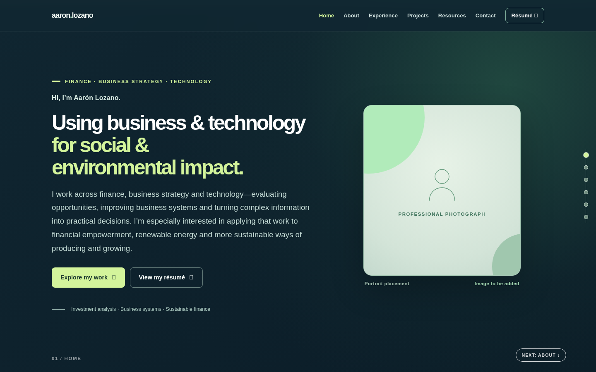

# Reusable website design and QA environment

Verified on 16 November 2026 in the attached Codex Cloud Linux environment. The website remains static HTML, CSS and JavaScript; this tooling has no production build step or runtime dependency. The prior [homepage audit](audit/REPORT.md) and its screenshots remain the historical baseline.

## Installation results

| Tool | Repository scope / source | Verified result |
| --- | --- | --- |
| Impeccable skill 4.9.2 | `.agents/skills/impeccable/`, official [pbakaus/impeccable](https://github.com/pbakaus/impeccable), pinned source `d41d9860b0094dcb68030657da63461212835aaa` | Existing installation retained. `engine-probe` returns `impeccable-engine 0.1.25`; `detect index.html --json` executes successfully and returns parseable findings. Exit 2 means findings, not a broken installation. |
| Vercel web-design-guidelines 1.0.0 | `.agents/skills/web-design-guidelines/SKILL.md`, official [vercel-labs/agent-skills](https://github.com/vercel-labs/agent-skills), pinned source `1a2c79d4e6c4a2283dc2c614b6538cbe1ed5ca62` | Read the complete skill and referenced guideline document before installing. Manual copy matches upstream byte for byte. This skill directory contains exactly one Markdown file and **no scripts, dependencies, hooks or executables**. Upstream README declares MIT licensing. |
| Modern Web Guidance 1.0.1 | `.agents/skills/modern-web-guidance/` plus the locked official Google Chrome npm package; [installation and review notes](docs/modern-web-guidance.md) | Added 17 November 2026. Adapted repository skill and local CLI wrapper; search/retrieval verified with telemetry disabled and runtime network/subprocess calls blocked. No installer, automatic updater or DevTools integration enabled. Requires Node 22+. |
| Playwright Test 1.57.0 | Official Microsoft `@playwright/test` package, pinned in `package.json` and integrity-locked in `package-lock.json` | Ordinary local browser runner; desktop, tablet and mobile projects configured. Uses installed Chromium through an explicit executable override in this cloud environment. |
| axe integration 4.11.0 | Official Deque `@axe-core/playwright` package, pinned and integrity-locked | Records accessibility observations during chapter walkthroughs; existing findings do not fail smoke tests. |
| Playwright MCP | No callable Playwright MCP tools are exposed in this Codex Cloud session | Not installed or enabled. Cloud desktop capability alone does not establish Playwright MCP support. Ordinary Playwright works without MCP. |

The installed Vercel skill's SHA-256 is `f4647ca866a3accf763777f83e7682954f0187cd6bea7eea0399796652414e8f`. The reviewed guideline document's SHA-256 was `d246b026f4f29b5823a9cc857f9edf3d2507002e055e32040cadeaf3b38e0234`.

### What was reviewed

Impeccable's main skill, document/audit playbooks and shell launcher were inspected before the initial installation; its pinned engine download is checksum-verified. [Installation provenance](.agents/skills/IMPECCABLE.md) records the manual-copy method. A fresh probe and detector invocation verified usability for this setup task. The engine cache is `/workspace/.impeccable-cache`, outside this repository; no binary is committed.

Vercel's skill instructs the agent to fetch [the latest Web Interface Guidelines](https://raw.githubusercontent.com/vercel-labs/web-interface-guidelines/main/command.md), read requested files and produce `file:line` review findings. The referenced document was also inspected. It contains review rules, not a script, and does not request credentials, an account connection or deployment. It includes general writing and framework advice that must be evaluated in context: it does not authorize rewriting this personal portfolio, changing first-person copy, installing React/Next.js or replacing established branding.

The skill file is pinned by the source commit above, but its guideline URL tracks `main` and may change. Fetch and inspect it before future reviews as the skill requests. If offline, disclose that current guidelines could not be fetched; a prior audit is not a fresh Vercel review. No background fetcher or external account integration was added.

No design hooks, Git hooks, MCP server configuration, Vercel account connection, telemetry service, CI integration or deployment automation is enabled by this setup. Ask the owner before adding any of these. The existing GitHub Pages publishing configuration is untouched.

## Design guidance

[DESIGN.md](DESIGN.md) already exists and is retained as the source of truth: navy, green, cream, mint and lime values; Inter-first system typography; the six-chapter cascade; desktop activation conditions; native mobile scrolling; responsive grids; container gutters; spacing; transitions and reduced motion. Inter is named in CSS but is not downloaded by the site. A setup request is not permission to add font requests or modify the UI.

Codex-compatible clients discover repository skills under `.agents/skills/`. Reload the client if a newly installed skill does not appear in its skill picker. Agents can still read the files directly; automatic skill discovery is client-dependent.

## Reproduce browser QA

Use Node 22 or newer (required by the optional Modern Web Guidance CLI), npm and Python 3. Install the locked official npm packages with lifecycle scripts disabled:

```sh
npm ci --ignore-scripts
npx playwright install chromium
npm test
```

The dependencies resolve from `registry.npmjs.org` with lockfile integrity hashes. No additional dependency or package installer is needed for Vercel's Markdown skill. Browser installation is an explicit official Playwright command; it is not an enabled hook or account integration.

The cloud machine already supplies `/usr/bin/chromium`. Use it without downloading another browser:

```sh
PLAYWRIGHT_CHROMIUM_EXECUTABLE_PATH=/usr/bin/chromium npm test
```

The configuration starts Python's static server on `127.0.0.1:4173` and stops it after the run. There is no application build. Projects use desktop 1440×900, touch tablet 768×1024 and touch mobile 390×844. The suite navigates all six chapters, saves screenshots and geometry, records axe findings, exercises a native disclosure and checks the résumé route. Desktop-only probes cover wheel/PageDown, explicit-link history, reduced motion, focus, breakpoints, zoom-equivalent layout and synthesized touch.

Useful commands:

```sh
npm run test:desktop
npm run test:mobile
npm run test:screenshots
npm run test:report
```

Prefix any test command with the Chromium environment variable above when using the cloud system browser. `test:screenshots` runs the six-chapter walkthrough in all three projects, including its interaction assertions; it is not a visual-diff gate.

Fresh screenshots and JSON observations go to **`test-results/evidence/`**, ignored by Git. Set `QA_OUTPUT_DIR` to retain another run separately; relative paths resolve from the repository working directory. Historical `audit/` evidence is not overwritten by default. The Playwright HTML report is in `playwright-report/`; traces are retained for failures. Inspect evidence before deciding whether to promote it into versioned documentation. `AUDIT_BASE_URL` optionally targets a user-authorized alternate URL and disables the local server; it does not configure hosting or a service integration.

Known accessibility issues are documented in the audit. These tests assert current interactions and preserve observations rather than asserting the existing site is WCAG compliant. Chromium emulation does not establish Safari/Firefox, physical-device or screen-reader compatibility. Screenshot comparisons across different browser/font environments can differ even when the source is identical.

## Reproduce Impeccable verification

```sh
IMPECCABLE_HOME=/workspace/.impeccable-cache DO_NOT_TRACK=1 .agents/skills/impeccable/scripts/impeccable engine-probe
IMPECCABLE_HOME=/workspace/.impeccable-cache DO_NOT_TRACK=1 .agents/skills/impeccable/scripts/impeccable detect index.html --json
```

On another computer, omit `IMPECCABLE_HOME` to use the standard per-user cache. First use may download the pinned, checksum-verified engine. Pass `DO_NOT_TRACK=1` for these manual checks. The detector's findings are review prompts; do not turn them into automatic edits or infer compliance from an empty result.

## Verification run and screenshots

This section records the initial setup run before UI corrections. See the [A01–A04 follow-up review](docs/qa/a01-a04/REPORT.md) for the corrected site, expanded suite and updated screenshots; the original captures below remain the historical setup baseline.

The complete ordinary Playwright suite passed on 16 November 2026: **5 passed, 4 intentionally skipped duplicate desktop-only groups**, in approximately 1.8 minutes. All three viewport walkthroughs recorded six chapters and zero JavaScript page errors. The run produced 49 fresh screenshots in `test-results/evidence/screenshots/`. The focused screenshot command was also checked with `--list` and selects exactly the three device walkthroughs.

Runtime: Node 24.22.1, npm 11.9.0, system Chromium 156.0.8078.79. `npm ci --ignore-scripts` completed successfully from the lockfile. Both configuration/test files passed Node syntax checks. Impeccable's engine probe and detector executed; Vercel's installed file was compared to the reviewed source and hashed. No new hook or integration configuration was added.

Selected screenshots below were copied unchanged from this run and visually inspected. The mobile image is the actual first viewport; actions below the fold are an existing audited behavior, not a setup regression.

| Desktop · 1440×900 | Mobile · 390×844 |
| --- | --- |
|  |  |

`index.html`, `resume.html` and `favicon.svg` are byte-for-byte unchanged from the audited source revision `69af386`. The existing `DESIGN.md` and historical `audit/` evidence were retained without alteration. The complete test run's fresh observations remain available locally under the ignored results directory.
