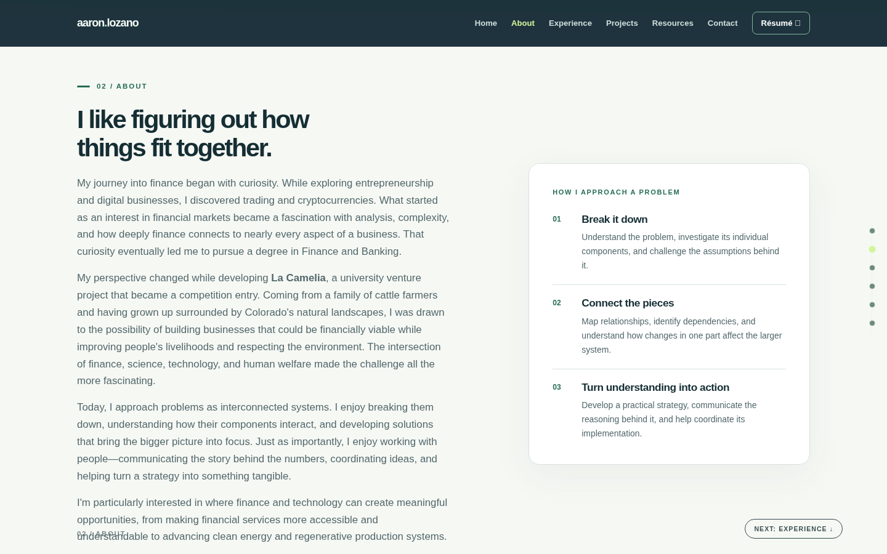

# Homepage audit — 16 November 2026

The existing six-chapter presentation has a coherent identity and working core interactions. Keep the content, navy/green/lime branding, chapter sequence and static implementation. Correct the reading and keyboard defects before adding visual embellishments. This audit implements no redesign or production fixes.

## Evidence and method

- Repository: `Aaronlxca/aaronlxca.github.io`, `main` at `69af386` (`69af386` is the abbreviated audited source revision).
- Production: https://aaronlxca.github.io/. The live HTML and checkout both had SHA-256 `00e508905e9b8be232bc182d43517340c0f71279f50e70d3ce37e37378c3d5ef` when checked.
- Captures: unchanged checkout served locally, Chromium through Playwright 1.57.0; axe-core through `@axe-core/playwright` 4.11.0. Screenshots were saved and visually inspected, including complete chapter captures and issue states.
- Main matrix: desktop **1440×900**, touch tablet **768×1024**, touch mobile **390×844**, all CSS pixels and device scale factor 1. Supplemental probes: **1280×720**, **1024×768** with fine pointer and with touch, **821×900**, **820×900**, **320×568**, and **720×450** (200% zoom-equivalent viewport from 1440×900).
- Actions: all six navigation destinations in each main size, mobile menu, hero work CTA, a project disclosure open/close, résumé route, desktop wheel and PageDown, explicit-link browser Back, deep-link loading, reduced-motion mode, Escape, skip link, post-navigation Tab and touch scrolling.
- Open [the screenshot gallery](gallery.html) for all accepted images. Main screenshots show the viewport; `-complete` images show an entire tablet/mobile chapter and can exceed one screen. They are not evidence that all chapter content fits above the fold.

## Audit health score

These are qualitative 0–4 Impeccable rubric scores supported by this run, not an automated certification.

| Dimension | Score | Evidence |
| --- | ---: | --- |
| Accessibility | 2/4 | Good semantics, focus styles and reduced-motion alternative; broken desktop skip behavior and footer contrast remain. |
| Performance | 3/4 | Lean static HTML, no application bundle or remote font requests; blur, backdrop blur and persistent stage compositing merit profiling. Frame rate was not benchmarked. |
| Theming | 2/4 | Shared palette variables coexist with many literal component colors and differing résumé token aliases. No theme switch is offered or required. |
| Responsive design | 3/4 | All chapters reachable; stacks and touch scrolling work, with desktop overflow/footer collisions and very small labels. |
| Implementation integrity | 3/4 | Consistent chapter system, truthful project stages and real native disclosures; focus and overflow handling need refinement. |
| **Total** | **13/20** | **Acceptable: significant targeted work remains; this does not require replacing the visual identity.** |

**Implementation integrity verdict: coherent existing system, with functional defects.** Impeccable’s stylistic warnings about numbered chapters, a radial hero wash and the named Inter font do not justify removing those brand choices. Measured reading and accessibility issues take priority.

## Chapter walkthrough

Follow the chapters in this order. Each screenshot cell opens the original saved capture; tablet/mobile cells also link to a complete chapter image.

| Step | Chapter and health | Desktop | Tablet | Mobile |
| --- | --- | --- | --- | --- |
| 1 | **Home — usable, hierarchy needs adjustment on mobile.** Clear proposition and contrasting CTA. The reserved portrait leads the mobile page and pushes both actions below the initial screen. | [Viewport](screenshots/desktop-01-home.png) | [Viewport](screenshots/tablet-01-home.png) · [Complete](screenshots/tablet-01-home-complete.png) | [Viewport](screenshots/mobile-01-home.png) · [Complete](screenshots/mobile-01-home-complete.png) |
| 2 | **About — needs correction on desktop.** Biography and three-step approach remain intact and readable, but the absolute footer intrudes into the biography. Mobile reading is long but flows without horizontal clipping. | [Viewport](screenshots/desktop-02-about.png) · [Bottom](screenshots/desktop-02-about-bottom.png) | [Viewport](screenshots/tablet-02-about.png) · [Complete](screenshots/tablet-02-about-complete.png) | [Viewport](screenshots/mobile-02-about.png) · [Complete](screenshots/mobile-02-about-complete.png) |
| 3 | **Experience — usable, minor density issues.** Metrics and chronological history scan well. Narrow job/date columns and smaller descriptions require more reading effort. Footer contrast needs correction. | [Viewport](screenshots/desktop-03-experience.png) | [Viewport](screenshots/tablet-03-experience.png) · [Complete](screenshots/tablet-03-experience-complete.png) | [Viewport](screenshots/mobile-03-experience.png) · [Complete](screenshots/mobile-03-experience-complete.png) |
| 4 | **Projects — healthy core interaction, minor typography/layout issues.** Stages and attribution are explicit; disclosure opens and closes successfully. The third card forms a lone second row on tablet. | [Viewport](screenshots/desktop-04-projects.png) · [Expanded](screenshots/desktop-projects-expanded.png) | [Viewport](screenshots/tablet-04-projects.png) · [Complete](screenshots/tablet-04-projects-complete.png) | [Viewport](screenshots/mobile-04-projects.png) · [Complete](screenshots/mobile-04-projects-complete.png) |
| 5 | **Resources — healthy structure, contrast needs correction.** Whole-card external links are distinct from the dashed planned-material card, which is correctly noninteractive. Third-card orphaning repeats on tablet. | [Viewport](screenshots/desktop-05-resources.png) | [Viewport](screenshots/tablet-05-resources.png) · [Complete](screenshots/tablet-05-resources-complete.png) | [Viewport](screenshots/mobile-05-resources.png) · [Complete](screenshots/mobile-05-resources-complete.png) |
| 6 | **Contact — healthy core flow.** Connection rows are clear and easy to locate. The résumé route loads; the email’s forthcoming status remains honest. Mobile secondary copy is somewhat dense. | [Viewport](screenshots/desktop-06-contact.png) | [Viewport](screenshots/tablet-06-contact.png) · [Complete](screenshots/tablet-06-contact-complete.png) | [Viewport](screenshots/mobile-06-contact.png) · [Complete](screenshots/mobile-06-contact-complete.png) |

## Ranked findings

**8 findings: 0 P0 blockers, 3 P1 major, 4 P2 minor, 1 P3 polish.** P1 means significant reading difficulty or a verified accessibility failure; P2 has a practical workaround; P3 is optional refinement.

### A01 · P1 · Desktop skip link does not bypass repeated navigation

**Location:** `index.html:252`, anchor interception at `index.html:484`. **Category:** accessibility. **Standard:** WCAG 2.4.1 Bypass Blocks.

From a fresh desktop load: Tab focuses “Skip to content”; Enter runs the deck navigation handler; the next Tab lands on the header wordmark. The handler prevents native anchor behavior and never transfers focus. The control therefore leaves keyboard users traversing the repeated header instead of entering the main content. [Focused control screenshot](screenshots/desktop-skip-focus.png); exact focus sequence is in `interaction-probes.json` → `skipThenTab`.

**Recommendation:** handle the skip action separately, move focus to `main` or the active chapter heading with a programmatically focusable target, and preserve the appropriate chapter position. **Acceptance:** Skip → Enter → next Tab reaches the chapter’s content action, without header or side-dot traversal. Suggested follow-up: `$impeccable harden`.

### A02 · P1 · Desktop About footer overlaps biography and hides the chapter boundary

**Location:** `index.html:64–73`, About layout at `index.html:87`. **Category:** responsive layout and reading accessibility.

At 1440×900, About has `scrollHeight=974px` in a `900px` chapter. Its content reaches y=886, but its footer occupies y=861–873: the final paragraph and chapter marker visibly collide. At 1024×768 with a fine pointer, content extends to y=874 while the footer starts at y=729. At 821×900, About needs 1141px of scroll height while its footer remains near y=861. Native internal scrolling keeps the text reachable; it does not reserve footer space. Scrolling to the bottom also moves the upper content underneath the fixed header.

**Recommendation:** place the footer/Next row after the content in normal chapter flow, or reserve a nonoverlapping layout row within the scroll container. Preserve the cascade, but let content height determine when internal scrolling is necessary and keep headings clear of the fixed header. Avoid solving this by shrinking the biography. **Acceptance:** no overlap at 1440×900, 1280×720, 1024×768 and 821×900, including expanded disclosures and bottom scroll. Suggested follow-up: `$impeccable layout`.

### A03 · P1 · Four chapter markers fail small-text contrast

**Location:** `index.html:64` (`opacity:.55`). **Category:** accessibility. **Standard:** WCAG 1.4.3 Contrast (Minimum).

The opacity composites inherited text into a low-contrast gray. axe reports the same four persistent footer failures across tablet/mobile states:

| Marker | Composited text / background | Contrast | Required |
| --- | --- | ---: | ---: |
| About | `#7a898a` / `#f6f8f4` | 3.40:1 | 4.5:1 |
| Experience | `#96aca5` / `#204b42` | 4.07:1 | 4.5:1 |
| Projects | `#7e8c8f` / `#ffffff` | 3.47:1 | 4.5:1 |
| Resources | `#768588` / `#ecf0ef` | 3.33:1 | 4.5:1 |

See the footers in each [complete mobile chapter](gallery.html#mobile-complete). They use 10.56px text on mobile and 11.52px on tablet. The desktop transformed/inert stage produced no axe violations, including a footer-only diagnostic; this is a measurement limitation, not proof of adequate desktop contrast. The same CSS color/opacity calculation remains applicable where the footer is unobstructed.

**Recommendation:** replace reduced parent opacity with explicit contextual footer colors that meet at least 4.5:1, retaining the quiet visual hierarchy through size and placement. Recheck the portrait label separately against actual gradient pixels: the detector’s conservative 3.7:1 gradient estimate is advisory, not a verified whole-label failure. Suggested follow-up: `$impeccable harden`.

### A04 · P2 · Chapter changes and menu dismissal do not manage focus predictably

**Location:** `index.html:440–453`, `index.html:473–490`, menu handler near `index.html:388`. **Category:** keyboard navigation and accessibility risk.

Activating the Projects header link leaves focus in the header; the next Tab reaches Resources. Activating Home’s Next link makes its source chapter inert; focus falls to the body, and the next Tab lands on About’s Next link rather than its heading. Escape closes the small-screen menu while a menu link is focused, leaving focus on the body. These exact states are in `targeted-diagnostics.json`; see [Next then Tab](screenshots/desktop-next-then-tab.png) and [open mobile menu](screenshots/mobile-menu-keyboard.png). No screen reader announcement was tested, so this is a verified focus behavior with an announcement risk, not a claimed screen reader failure.

**Recommendation:** for explicit chapter activation, focus the destination heading after the stage settles; for Escape, return focus to Menu. Keep wheel-driven reading from stealing focus. **Acceptance:** link/Next/Back navigation produces a visible, logical destination; Escape restores the menu button. Suggested follow-up: `$impeccable harden`.

### A05 · P2 · Functional labels are too small for comfortable reading and tapping

**Location:** `index.html:67`, `index.html:199–224`, project status rules near `index.html:130`. **Category:** typography and responsive usability.

Mobile Next labels are **9.28px**; portrait captions are also **9.28px**; project statuses are **10.72px**. The mobile Next target measures approximately **98×28px** and Menu approximately **85×39px**. These exceed the 24px WCAG 2.5.8 minimum dimension, so their failure to reach a 44px comfort target is **not** reported as an AA violation. Desktop side dots are 10px circles; equivalent header controls and spacing exceptions must be considered before calling those an AA failure.

**Recommendation:** bring functional metadata toward 12–14px and Next/Menu hit areas toward 44px while retaining compact visual outlines and uppercase hierarchy. Keep long job titles readable without shrinking them to fit. Suggested follow-up: `$impeccable typeset`, then `$impeccable adapt`.

### A06 · P2 · Mobile hero prioritizes an empty portrait over the work action

**Location:** `index.html:199–207` and hero markup. **Category:** responsive hierarchy and spacing.

At 390×844, the complete Home chapter is about **1102px** tall. The portrait’s `order:-1`, its captions, the eyebrow and lead paragraph put both CTAs below the initial screen. The existing copy is valuable; the problem is the vertical allocation before the first action. Compare [initial viewport](screenshots/mobile-01-home.png) and [complete chapter](screenshots/mobile-01-home-complete.png).

**Recommendation:** keep all copy and portrait status, but reduce the reserved portrait’s initial vertical footprint or position it after the introductory text/actions on narrow screens. Reduce the 109px initial content offset only as far as fixed-header clearance allows. **Acceptance:** the first work action is discoverable substantially earlier at 390×844 and 320×568 without hiding content. Suggested follow-up: `$impeccable adapt`.

### A07 · P2 · Desktop cascade ignores input for nearly a second after each move

**Location:** `index.html:72`, `index.html:450`, `index.html:466–471`. **Category:** motion and navigation usability.

The `.82s` stage transition and **880ms input lock** are deliberate and measurable. During that interval wheel/PageDown input is discarded. In tall chapters, users must also scroll internally before the next wheel gesture can advance, so the same gesture alternates between continuous reading and chapter movement. The [mid-transition capture](screenshots/desktop-transition-home-about.png) shows outgoing blurred content and the incoming chapter beneath the fixed header. The motion works; no dropped-frame claim is supported by this run.

**Recommendation:** preserve the cascading identity, but trial a shorter transition with a bounded queued next intent or a lock tied to transition completion. Clarify the transition from reading within About to advancing a chapter. Preserve the existing reduced-motion native-scroll alternative. **Acceptance:** rapid deliberate Next/PageDown actions behave predictably, without accidental multiple skips or lost intent; long-chapter content remains readable. Suggested follow-up: `$impeccable animate`.

### A08 · P3 · Tablet card grids leave a lone third card and uneven chapter rhythm

**Location:** `index.html:186` and card grid rules. **Category:** layout polish.

At 768×1024, both three-item grids become two columns, leaving a lone third item below. Projects reaches roughly 1386px and Resources 1064px, with large differences in section height. All items remain reachable, so this is visual rhythm rather than missing content. See [Projects](screenshots/tablet-04-projects-complete.png) and [Resources](screenshots/tablet-05-resources-complete.png).

**Recommendation:** explore a full-width final card or an earlier single-column switch while retaining the existing card order, categories and copy. Tune this after accessibility and overflow repairs. Suggested follow-up: `$impeccable layout`, ending with `$impeccable polish`.

## What works and should be preserved

- A recognizable palette, wordmark, consistent chapter labels and a strong opening statement.
- One H1, named sections, main/nav/header landmarks, labeled chapter navigation, native project disclosures, focus-visible rules and honest image alternative text.
- All six chapter links, hero work CTA, résumé destination and sampled project disclosure work at all three main sizes; no JavaScript page errors were recorded.
- Explicit chapter-link history returns correctly. Wheel and body-focused PageDown advance the desktop deck. Internal About overflow is scrollable.
- Mobile navigation opens and closes, updates expanded state and closes on selection. Native touch events moved the mobile document by 258px in the final swipe probe; content remained reachable. This is synthesized Chromium touch evidence, not a physical-device test.
- Reduced-motion emulation removes the desktop deck and exposes normal document flow. The work CTA arrived at the correct section; no reduced-motion defect was reproduced. The JavaScript `go()` helper contains a smooth-scroll fallback, but normal reduced-motion anchors do not exercise that branch, so it is not counted as a bug.
- Resource links use safe new-tab attributes. Planned resources remain noninteractive and correctly identified. Contact does not invent a public email address.

## Automation interpretation and evidence limits

The main run had **4 passing tests and 2 intentionally skipped duplicate cross-mode probes**. The separate final targeted diagnostic run passed. The final suite definition contains five applicable tests (three device walkthroughs and two desktop diagnostic groups); the duplicate groups are skipped in other projects. Existing accessibility failures are written to JSON rather than asserted as passing. This audit does not claim that passing smoke tests means the site passes WCAG.

Raw results: [desktop](desktop-results.json), [tablet](tablet-results.json), [mobile](mobile-results.json), [interaction probes](interaction-probes.json), [targeted diagnostics](targeted-diagnostics.json), [Impeccable detector](impeccable-source.json). The detector exited 2 to signal findings. It was run against the source HTML, not claimed as a pixel-aware URL scan. Reported findings were reviewed against rendered evidence:

- **Confirmed:** four footer contrast failures, undersized functional labels, and the overflow/focus defects found by browser checks.
- **Contextual/advisory:** numbered chapter labels, Inter naming and radial background are established design choices. Preserve them. “Cramped padding” on the centered portrait wrapper is not supported by the capture; the silhouette is visibly inset. The “dark glow” flag is not grounds to replace the very faint About shadow. Gradient contrast needs pixel-level rechecking.
- **Off-screen reveal noise:** tablet/mobile axe runs include many nodes in other chapters whose `.wrap` is temporarily at `.72` opacity. Counts vary as chapters become visible. Do not count those duplicate/off-screen nodes as dozens of independent persistent text failures. The report’s contrast finding uses the four stable chapter footers outside those reveal wrappers.
- **Fonts and glyphs:** no Inter asset is loaded. This Linux capture shows replacement boxes for some diagonal-arrow glyphs. This may differ on the owner’s system. Verify the intended fallback font and use consistent inline SVG for decorative arrows if needed; do not change the brand typeface based on an environment-specific rendering alone.
- **No-JavaScript diagnostic:** all six sections remain in the document, but the small-screen menu remains hidden and its button cannot open it. Next links/native scrolling provide access. Consider a progressive menu fallback in later hardening.
- **Touch tooling:** the first high-level CDP synthesized scroll was a no-op. A follow-up using native `touchStart`/`touchMove`/`touchEnd` events did move the document. Both observations are retained; the first is not treated as a site bug.
- **Zoom:** shrinking the viewport to 720×450 exercises similar layout pressure to 200% zoom on 1440×900. It is not actual browser zoom or OS text scaling. The 320px probe showed no document-wide horizontal overflow, but this is not a full reflow compliance claim.
- **Not tested:** Safari/WebKit, Firefox, physical iOS/Android devices, assistive technology announcements, forced colors, browser text-only zoom, external sites’ availability/sign-in flows, sustained low-end-device animation performance or the full résumé interaction set. No Lighthouse score or cross-browser certification is implied.

## Recommended implementation order

1. **P1 — `$impeccable harden`:** fix the skip target/focus behavior and footer contrast; verify keyboard focus after explicit chapter changes and Escape.
2. **P1 — `$impeccable layout`:** move footer/Next controls out of overlapping positions while preserving the cascade and every paragraph.
3. **P2 — `$impeccable typeset` and `$impeccable adapt`:** improve small labels, comfortable hit areas and mobile hero action visibility. Confirm font/glyph rendering in the owner’s browsers.
4. **P2 — `$impeccable animate`:** tune the deck’s duration and input handling after content/focus behavior is correct; retain native touch and reduced-motion paths.
5. **P3 — `$impeccable layout`, then `$impeccable polish`:** balance tablet card rows and spacing; rerun this audit and compare the same captures.

These are recommendations only. The production `index.html`, `resume.html` and `favicon.svg` are unchanged. No framework, redesign, new content or deployment change is included.
