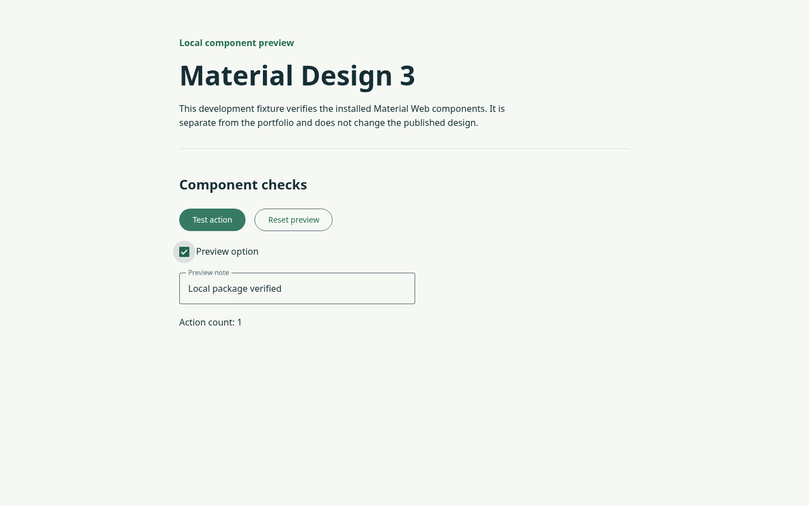
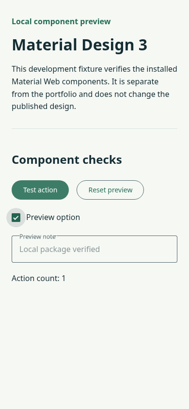

# Material Design 3 installation

The requested reference is Google's [Material Design 3 get-started guide](https://m3.material.io/get-started). Its official web implementation is [Material Web](https://github.com/material-components/material-web), published as `@material/web`. This is a web-component library and design system, not an agent skill or a Stitch account connection.

## Installed scope

- **Package:** `@material/web@2.5.0`, pinned as a development dependency in this repository.
- **Publisher source:** `material-components/material-web`; documentation/source reviewed at commit `cde70821773725440f1f60cc7a2a0afc8da8e239`.
- **License:** Apache 2.0; package license/copyright notices remain in `node_modules/@material/web/`.
- **Published package integrity:** `sha512-x2Uovyq8E/Zc1xHXd9s1eBMXF5pMHVAt70pISKd0fL3Ajj4L6zQaQUY/awcfR2RDAMKXC7i4+vr0arv1YaOR/g==`.
- **Package review:** the exact published tarball and package manifest were inspected before installation. It contains compiled JavaScript and no `preinstall`, `install`, `postinstall` or `prepare` lifecycle hooks. Upstream Wireit build/test scripts were inspected but not run or installed as project tooling.
- **Installation:** `npm install --save-dev --save-exact --ignore-scripts @material/web@2.5.0`. Transitive Lit/context/tslib dependencies are integrity-locked in `package-lock.json`.

**Maintenance status:** upstream explicitly marks Material Web as in maintenance mode pending new maintainers. Its roadmap says no new feature/component work is currently planned. The package does not supply every component or the full Material 3 Expressive feature set. Evaluate this constraint before choosing it as a production foundation; this setup enables local evaluation without adopting it in the portfolio.

## Local preview

```sh
npm ci --ignore-scripts
npm run preview:material
```

Open **http://127.0.0.1:4173/_dev/material3.html**. Stop the server with Ctrl+C.

The separate development fixture uses locally installed ES modules and an import map. It demonstrates filled/outlined buttons, a checkbox and an outlined text field. Its sample green/cream variables borrow existing palette values solely to demonstrate theming; they do not replace `DESIGN.md` or the portfolio's CSS. It loads no CDN scripts, Google Fonts, analytics or external account services. A modern browser with import-map, Web Component and ElementInternals support is required.

The `_dev` fixture is not linked or imported by `index.html` or `resume.html`. No production page, stylesheet, content, navigation or interaction has changed. No new build step, framework, hooks, MCP server, integration or deployment is enabled. Any future production component adoption or design change requires explicit approval.

## Verification

```sh
PLAYWRIGHT_CHROMIUM_EXECUTABLE_PATH=/usr/bin/chromium npm run test:material
```

Without a system Chromium override, first install the normal Playwright Chromium browser with `npx playwright install chromium`.

The smoke test checks custom-element registration, keyboard button activation, keyboard checkbox operation, text-field entry and reset, viewport overflow, page errors and unexpected external requests. It captures desktop/tablet/mobile previews under `test-results/evidence/screenshots/` (or `QA_OUTPUT_DIR`). This test is skipped when `AUDIT_BASE_URL` targets a deployment, since the fixture depends on local `node_modules` and is not a production page.

The existing `npm run test:screenshots` command continues to check only the six homepage chapters. Package installation does not apply Material styling globally or make the portfolio conform to Material guidelines automatically.

Verified on 17 November 2026: a clean `npm ci --ignore-scripts` succeeded and all **3 Material smoke tests passed** (desktop 1440×900, tablet 768×1024, mobile 390×844). No JavaScript page errors, external requests or horizontal overflow were recorded in the component preview. Screenshots were saved and visually inspected.

The full repository suite also passed: **12 passed, 6 intentionally skipped** duplicate desktop-only groups. The homepage's existing responsive axe `color-contrast` diagnostic rule/target sets match the committed A01–A04 baseline in all three viewports; passing tests are not a claim of full accessibility conformance. Production files are unchanged.

| Desktop preview | Mobile preview |
| --- | --- |
|  |  |

## Design guidance for coding agents

Use [DESIGN.md](../DESIGN.md) as the authority for the current site. Consult [Material foundations](https://m3.material.io/foundations), [typography](https://m3.material.io/styles/typography/overview) and [color roles](https://m3.material.io/styles/color/roles) when explicitly asked to explore Material-based alternatives. Treat these as reference guidance and component capabilities, not permission to change Inter-first typography, the existing palette, six-chapter cascade, copy or career facts.

For an approved production implementation, import only the components needed, decide how their modules will be delivered, test keyboard/accessibility behavior in context and review browser coverage. Keep the local fixture's `node_modules` import map out of production HTML; GitHub Pages does not install or serve those dependencies for the existing static deployment.
