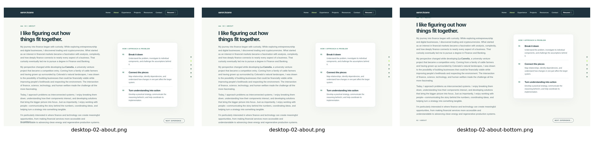
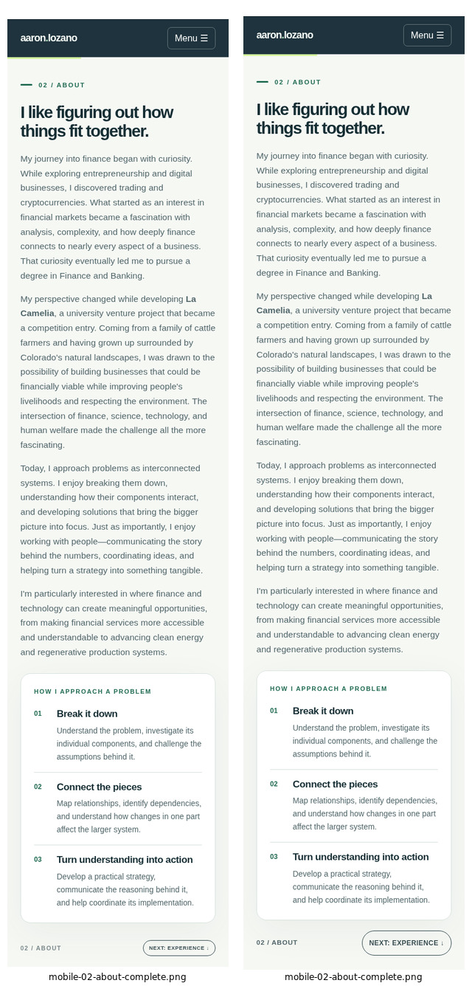

# A01–A04 correction review — PR #1

Reviewed on 16 November 2026 against the original [audit](../../../audit/REPORT.md) at source revision `69af386`. The incoming PR corrections were `8ed951c` (UI changes) and `b44dafa` (regression assertions). This follow-up preserves the content, navy/green/cream identity, desktop cascade and native mobile scrolling. Nothing was merged or deployed.

## Result

The four requested audit areas pass the expanded Chromium checks. The original audit screenshots remain unchanged. [Updated gallery and before/after comparisons](gallery.html) show the current captures; raw geometry, focus observations and detector output are stored beside this report.

| Area | Original audit / incoming correction | Verified outcome |
| --- | --- | --- |
| **A01 · Skip link** | Desktop skip returned users to header navigation. Incoming code focused Home. | Tab → Skip → Enter focuses Home’s heading; the next Tab reaches the work CTA. Verified on desktop, tablet, mobile and in reduced motion. |
| **A02 · Footer/content separation** | Desktop About marker overlapped its final paragraph. Incoming code moved footer controls into flow, but centered overflowing columns above the safe reading area on shorter desktops. | Retained the normal-flow row and corrected overflow alignment. All six chapters keep at least **18px** between content/visible text and the footer row in the checked states. Content starts below the fixed header at every tested narrow/short breakpoint. |
| **A03 · Chapter label contrast** | Four footer markers measured 3.33–4.07:1. Incoming code removed opacity and selected contextual colors. | All eyebrow and footer labels exceed **4.5:1** in every primary viewport. Lowest tested ratio: **5.21:1**. |
| **A04 · Focus after navigation** | Incoming focus handling covered the desktop deck and Escape, but not normal mobile/reduced-motion links; history could also clear destination focus. | Explicit header/Next links focus the heading in all modes. Back restores visible destination focus after browser history restoration. Returning to the URL without a fragment restores Home. Reselecting a scrolled desktop chapter resets its internal scroll so the focused heading is visible. Escape restores Menu focus. |

## Regressions and gaps corrected in this follow-up

- `index.html:245` — overflowing column centering moved About content under the header at 1280×720, 1024×768 and 821×900. `justify-content:flex-start` now handles overflow; existing automatic content margins retain centering when there is free space.
- `index.html:255` — heading outlines appeared on pointer navigation because styles targeted `:focus`. They now use `:focus-visible`, retaining keyboard indication without adding a pointer-only rectangle to every chapter heading.
- `index.html:470` — choosing the current desktop chapter did not reset its internal scroll, so focus could point to an off-screen heading. Explicit navigation now resets it, while wheel direction handling remains intact.
- `index.html:520` — native-flow links returned before focusing the destination. They now keep smooth scrolling (instant under reduced motion), update the fragment and focus the heading without forcing an extra scroll. Modified link clicks retain browser behavior.
- `index.html:529` — focus set during `popstate` could be cleared by browser history restoration. It is restored on the next animation frame, including a return to Home without a fragment.

These are narrow accessibility/layout corrections. The homepage’s visible text was parsed and compared against `69af386` and matches exactly. No résumé content or favicon was changed. `DESIGN.md` and its sidecar now describe the corrected footer and focus behavior.

## Tests and evidence

Reproduction:

```sh
npm ci --ignore-scripts
PLAYWRIGHT_CHROMIUM_EXECUTABLE_PATH=/usr/bin/chromium npm test
```

The complete expanded suite passes: **9 passed, 6 intentionally skipped** duplicate desktop-only groups. The original incoming suite also passed before the deeper checks; passing those five original tests alone did not cover mobile focus, post-history focus or the short-desktop header regression. The new assertions caught and now protect these cases.

The new text-boundary check excludes content inside closed disclosures; hidden text is not treated as a visible overlap. Expanded-disclosure content is included and tested. Missing HTML class attributes are treated as normal native-scroll mode, not as a test failure.

Main matrix:

| Device | CSS viewport | Checks |
| --- | --- | --- |
| Desktop, fine pointer | 1440×900 | Six chapters, skip/tab order, heading focus and viewport visibility, Next links, Back, no-fragment Back, same-chapter reset, all disclosures expanded, footer separation, label ratios, wheel/PageDown, cascade state, reduced motion. |
| Tablet, touch emulation | 768×1024 | Six chapters, skip/tab order, heading focus and visibility, Next/Back, expanded disclosures, footer separation, label ratios, native scrolling mode and mobile menu behavior. |
| Mobile, touch emulation | 390×844 | Same chapter/focus/layout checks; native touch input is also asserted to move the document. |

Additional footer/header/overflow matrix: all six chapters at **1280×720, 1024×768, 821×900, 820×900 and 320×568**, giving 30 additional layout cases. A 720×450 zoom-equivalent capture, 1024×768 coarse-pointer probe and all-open project disclosures supplement the review. Long desktop chapters may require internal scrolling; their entire text remains reachable and the footer is after it. A viewport capture is not a claim that the whole chapter fits above the fold.

The suite records no JavaScript page errors in any primary viewport. It asserts desktop cascade activation, wheel/PageDown advancement, reduced-motion fallback and native mobile touch scrolling. The native touch diagnostic moves the document rather than merely resizing a desktop viewport. This is Chromium emulation, not a physical-device result.

Evidence files:

- [Desktop checks](desktop-a01-a04.json), [tablet checks](tablet-a01-a04.json), [mobile checks](mobile-a01-a04.json).
- [30-case footer/header matrix](breakpoint-footer-matrix.json).
- [Interaction probes](interaction-probes.json) and [targeted diagnostics](targeted-diagnostics.json).
- [Desktop axe observations](desktop-results.json), [tablet observations](tablet-results.json), [mobile observations](mobile-results.json).
- [Impeccable source detector](impeccable-source.json).

## Contrast comparison

These ratios use computed opaque foreground/background colors for the chapter markers. For Home’s gradient, the test uses the lightest declared hero background endpoint as a conservative bound rather than assuming a transparent or uniform navy background. Both eyebrow and footer opacity are asserted to be 1 in the active chapter.

| Chapter footer | Original audit | Corrected |
| --- | ---: | ---: |
| About | 3.40:1 | **5.60:1** |
| Experience | 4.07:1 | **8.10:1** |
| Projects | 3.47:1 | **5.98:1** |
| Resources | 3.33:1 | **5.21:1** |

The same computed label colors/ratios apply in the three primary viewports; mobile labels are larger than in the original audit. Impeccable no longer flags the four footer contrast failures. It still reports an advisory 3.7:1 estimate for text on the portrait placeholder’s gradient; that is separate from the chapter labels and needs pixel-aware verification before being called a confirmed failure.

## Screenshot comparison

Desktop About, left to right: original audit top, corrected top, corrected bottom after internal scrolling. The original marker intrudes into biography text; the corrected row follows the full content and is accessible by scrolling.



Mobile About, left to right: original and corrected complete chapter. Biography and approach text remain intact; the marker is darker and Next has a more readable label and a 44px minimum height.



All six chapters were visually inspected in desktop captures and complete tablet/mobile captures:

1. **Home — usable:** identity, copy, portrait status and actions preserved; mobile first-screen hierarchy is an existing remaining issue.
2. **About — corrected:** no footer collision; short-desktop content clears the header and remains scrollable.
3. **Experience — usable:** timeline and metrics preserved, footer contrast corrected.
4. **Projects — usable:** disclosures work; closed and all-open states keep controls below content.
5. **Resources — usable:** external resource cards and the planned card remain distinct; footer contrast corrected.
6. **Contact — usable:** connection rows and résumé navigation preserved; the longer copyright label wraps without crossing content.

## Design skill review and unresolved items

Used the installed Impeccable audit/hardening/layout guidance and its source detector, plus the installed Vercel skill with a fresh fetch of the official Web Interface Guidelines. The focused guideline checks covered semantic navigation, visible keyboard focus, sticky-header clearance, reduced motion, deep-link/history behavior and layout overflow. Generic copy/font advice was not used to rewrite the owner’s content or branding.

The detector exits 2 for findings, not execution failure. Its remaining design-system literal, small-type, radius and stylistic advisories were checked against the incumbent system. Numbered chapters, Inter-first typography and the radial background are established choices, not regressions to remove. The source detector is not a rendered contrast certification.

No A01–A04 problem remains reproduced in the tested matrix. The following remain outside the completed corrections:

- **A05, partly unresolved:** Next links and footer labels improved; small portrait captions and project statuses remain.
- **A06:** the mobile reserved portrait still pushes the first actions below the initial viewport.
- **A07:** the .82s desktop cascade and 880ms input lock remain deliberate existing behavior; rapid-input tuning is not included.
- **A08:** three-card tablet grids still leave a lone third card.
- **Existing resilience limits:** the no-JavaScript mobile menu fallback and some platform-dependent arrow glyphs remain as documented in the original audit.
- **Verification limits:** Safari, Firefox, physical devices, screen-reader announcements, text-only zoom and forced-colors rendering were not tested. Off-screen mobile reveal opacity can produce duplicate axe contrast observations; the chapter-label results above come from active, fully visible chapters. Passing this suite does not certify the whole site for WCAG AA.

No automatic hooks, new integrations, dependency upgrades, merge or deployment were enabled.
